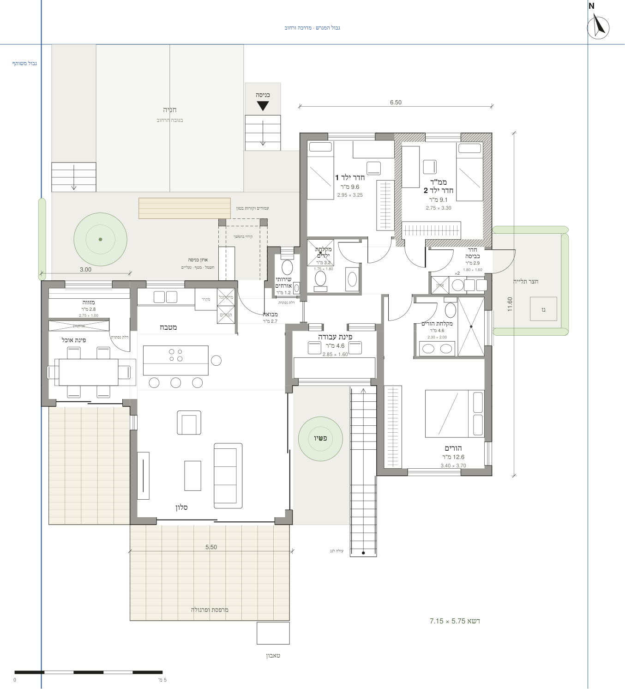
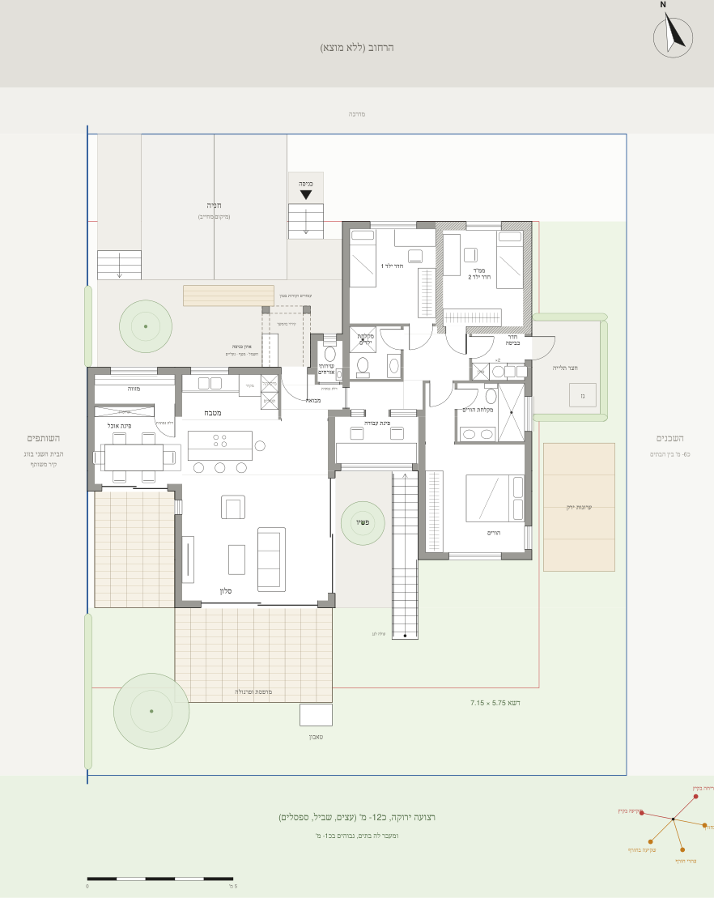
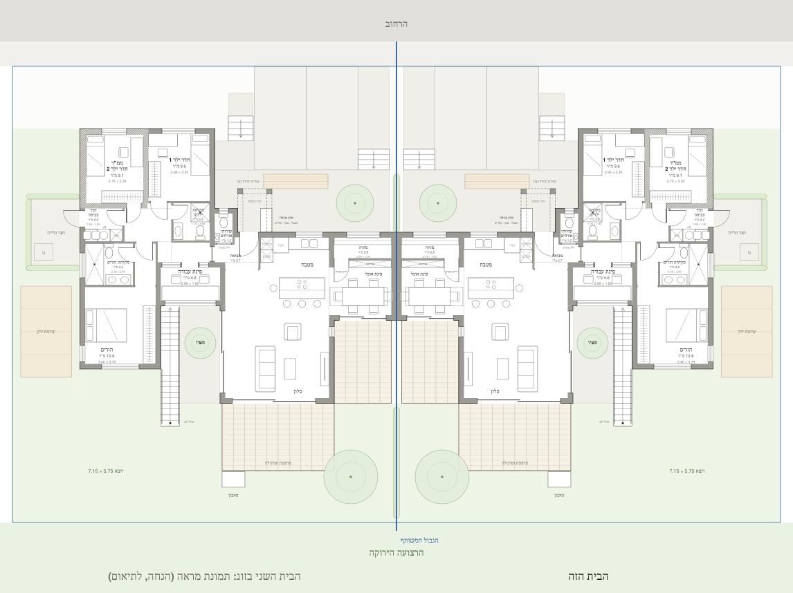
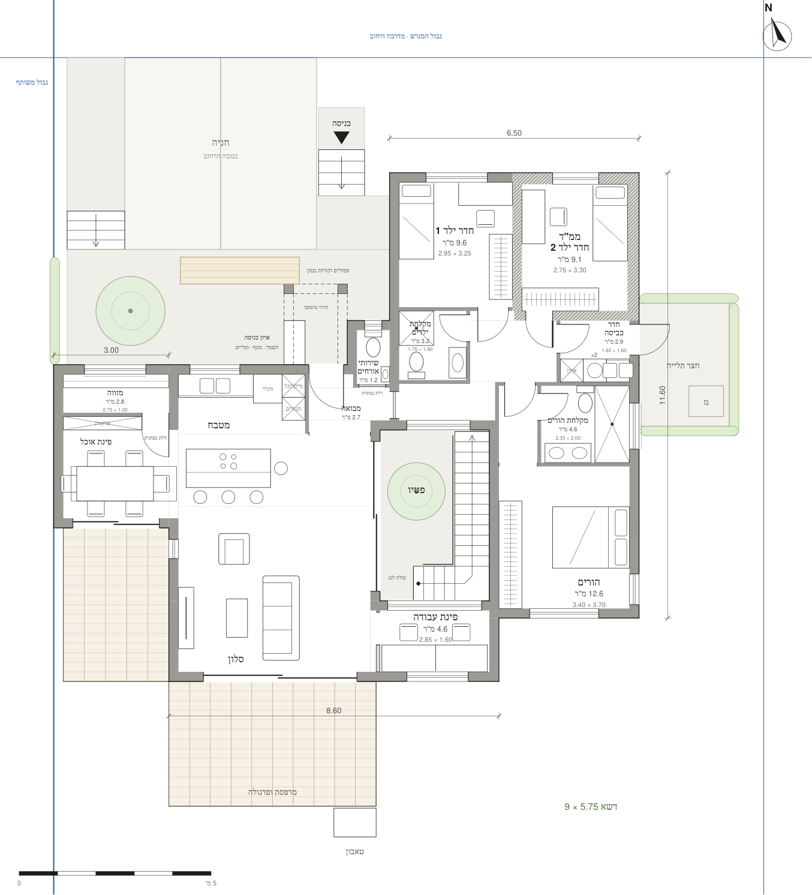

# הדוגמה: הבית השני בזוג

התוכניות של המשפחה שתכננה ראשונה בשיטה הזאת, על אותו מגרש מייצג, באוקטובר 2026. הן כאן כדי לראות איך נראים התהליך, השרטוטים והבדיקות, ולא כתבנית: הבית שלכם מתחיל מהבריף שלכם.

## מה יש

- **שלוש צורות שונות באמת** (שלב 2): לכל צורה רעיון אחר לגבי הקיר המשותף והגינה.
  - **1 · שתי חצרות:** הבית מתרחק מהגבול בחזית ובאחור.
  - **2 · חצר כניסה:** אגף הלילה מתקדם לרחוב.
  - **3 · פטיו:** פטיו פתוח לשמיים בלב הבית.
- **שני דגמים מפותחים מצורה 3** (שלב 3), אחרי כמה סבבי הערות והקטנה משיקולי תקציב:
  - **3ב · פטיו, מוקטן:** כ-129 מ"ר. הפטיו סגור מארבעה צדדים.
  - **3ג · פטיו לגינה:** כ-128 מ"ר. פינת העבודה והפטיו מתחלפים, והפטיו פתוח לגינה.

| 3ג · תוכנית | 3ג · על המגרש |
|---|---|
|  |  |

| 3ג · שני הבתים | 3ב · תוכנית |
|---|---|
|  |  |

## איך רואים את הדף המלא

הדף `deliverables/example/page.html` כולל:
- את כל התצוגות של כל דגם: תוכנית, מסלולים, על המגרש, גג ושני הבתים.
- הדמיה בתלת-ממד.
- זום, והבדיקות האוטומטיות.

אפשר לפתוח אותו בדפדפן, אחרי שמורידים את המאגר. אפשר גם לבקש מ-Claude לבנות אותו מחדש, עם `build_page.py example`, ולשלוח אותו.

## מה כדאי לקחת מכאן, ומה לא

- **לקחת:**
  - את הדרך: קודם החוץ והאנשים, אחר כך כמה צורות, ואז פרטים.
  - את סגנון השרטוט, את הבדיקות ואת ההדמיה.
  - את עקרונות הזוג: חדרי השינה רחוק מהקיר המשותף, וחצרות בצד המשותף.
- **לא לקחת:**
  - את הפרוגרמה: מספר החדרים, הגדלים, פינת העבודה, המזווה, הפטיו ומרפסת הגג. כל אלה באו מהשגרה ומהתקציב של המשפחה ההיא.
- **התיאום:** בתצוגה "שני הבתים" כל בית מצויר עם תמונת המראה שלו. כשיהיו לכם דגמים, כדאי לשים את שני הבתים האמיתיים זה ליד זה, ולתאם את הקיר המשותף ואת החצרות.
